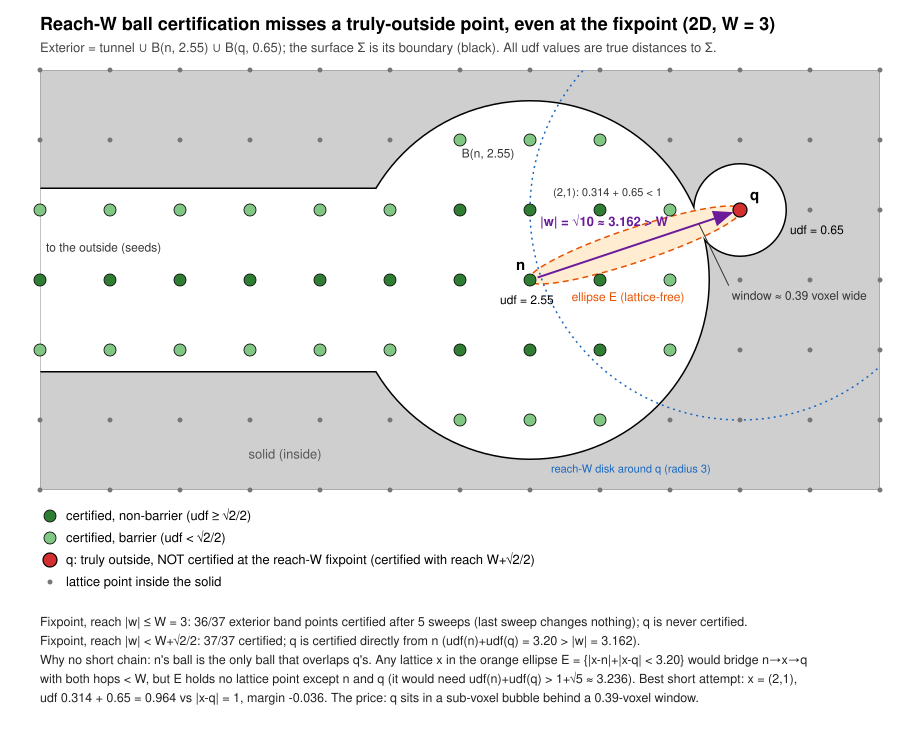

# A new approach to signing the distance field

> Working notes for an ongoing design discussion (branch `new-distancing-approach`). The
> construction itself (union-of-balls exterior + exact-distance interior) is proposed and
> empirically validated (soundness + axis-aligned tightness).
>
> **The 2D lattice-gap question posed at the end of this document is now closed.** See
> **`LatticeCertificationGap.md`** for the result (`eps* = (3-sqrt5-sqrt(2 sqrt5-4))/4 =
> 0.0192026307637963438...` at `W = 3`, proved, attained, with the exact `W`-plateau and an exact
> curvature law for non-planar interfaces) and **`LatticeCertificationGap_PriorArt.md`** for the
> literature review. Scripts: `scripts/distancing_experiments/lattice_gap/`.
>
> **Three corrections to this document fall out of that work** and are noted inline below where they
> apply: (a) the `eps*` figures computed here use the *ball-membership* criterion, which is exactly
> **2x** the constant for the *pairwise enrichment* rule the pipeline actually implements; (b) the
> golden-ratio discussion was asking the wrong question — the `W=3` worst case is a
> Farey-neighbour crossover, not a Diophantine-type question; (c) a straight `Sigma` is **not** the
> worst case, so the whole "planar interface" framing below is a lower bound, not a bound.
>
> The 3D generalization is open and under active investigation.

## Motivation

Both existing pipelines — nanovdb's `MeshToSDF` and OpenVDB's `meshToVolume.h` — determine
inside/outside for the bulk of the narrow band via a form of connected-components-plus-seed
reasoning (nanovdb: the CC component touching the global min-x active voxel is exterior, every
other CC component is interior). This is provably correct for a single, simply-connected,
watertight surface, but is known to mislabel:

- **separated objects** — a second, disjoint object's outer shell has no seed of its own and is
  wrongly folded into "interior";
- **nested / hollow shapes** — a single exterior seed cannot express the alternating
  inside/outside parity of nested shells.

(See `InclusionSigningDesign.md` for the previously-designed, not-yet-implemented fix along these
lines: partition into closed surfaces, build one SDF per surface, recover nesting via a sign
query, and compose with even-odd parity.) This document is a from-scratch reconsideration of the
signing problem itself, starting from first principles / desired properties rather than patching
the existing heuristic.

## Common ground (verified against both codebases)

Before diverging, we confirmed both pipelines agree on the first two stages:

1. **Rasterize a narrow-band UDF + nearest-primitive sidecar**, once, shared by everything
   downstream.
   - OpenVDB `MeshToVolume.h`: `VoxelizePolygons` computes per-voxel closest-point *unsigned*
     distance (min-combined over triangles via `combineData`), alongside an `Int32` `indexTree`
     recording the nearest polygon per voxel.
   - nanovdb `MeshToSDF.cuh` step 1 (`getHandleAndUDFAndIndex`): same shape — UDF + packed
     nearest-triangle-index sidecar (CAS-min on dist+triID).

2. **Barrier / "danger zone" criterion.** A voxel is classified *barrier* (its sign cannot yet be
   safely determined) iff
   ```
   |udf| <= (sqrt(3)/2) * h        <=>        udf^2 < 0.75 * h^2
   ```
   where `h` is the voxel size. Both codebases use exactly this constant (nanovdb
   `UDFBarrierPruneMaskFunctor`, explicitly commented as mirroring OpenVDB; OpenVDB's pervasive
   `0.75` threshold on squared voxel-unit distance throughout `MeshToVolume.h`, e.g.
   `ComputeIntersectingVoxelSign`, `SweepExteriorSign`, `traceExteriorBoundaries`).

   **Geometric justification.** `sqrt(3)/2 * h` is the circumradius of a cubic voxel cell (center
   to corner distance). For any point `p` inside that cell, the triangle inequality gives
   `dist(p, surface) >= dist(center, surface) - dist(center, p) >= d - (sqrt(3)/2)h`, where
   `d = udf(center)`. So `d > (sqrt(3)/2)h` proves the surface cannot cross the cell at all — the
   whole cell is unambiguously one-sided, and the center's sign can stand for the whole voxel.
   `d <= (sqrt(3)/2)h` gives no such guarantee: barrier.

3. (Not re-derived in detail, but both sides understood): downstream, non-barrier voxels are
   signed via connected components + a seed rule (nanovdb `signNonBarrier`), and barrier voxels
   are re-signed afterward by searching for a proven-exterior neighbor (nanovdb `signBarrier`,
   explicitly mirroring OpenVDB's `ComputeIntersectingVoxelSign`). This is the stage whose
   single-seed assumption is the known weak point above.

## New track: properties first

Rather than patching the seed rule, the discussion is enumerating *properties* the eventual
signing scheme must satisfy, before committing to a mechanism.

### What counts as an "implicit geometry representation"

Deliberately left as general as possible: at minimum, a classification of every point in space as
inside/outside. Additional structure — e.g. a true signed-distance magnitude, as a classical SDF
provides — is an optional extra property, not assumed up front.

### Property 1 — the "inclusion" property

**Statement (sharpened):** the *outside* set of the implicit geometry representation must never
intersect the input surface:
```
{ x : f(x) > 0 }  ∩  Σ  =  ∅
```
where `Σ` is the input surface (continuous), or, once discretized, its voxel proxy — **the
barrier shell** (§ "Barrier / danger zone criterion" above), the only set of voxels that could
possibly contain a surface point. On the grid:

> Every barrier voxel is unconditionally classified "inside" — not resolved case-by-case via a
> neighbor-search proof, the way `signBarrier`/`ComputeIntersectingVoxelSign` do today. "Outside"
> is only ever assigned to voxels that are both non-barrier *and* provably reachable from true
> exterior space without crossing a barrier voxel.

This reading was confirmed as the intended one. It directly targets the separated-object failure
mode: since it is defined per-voxel with no single global seed, every closed barrier shell —
however many there are, wherever they are — has a well-defined attempt at an adjacent exterior
region, rather than only the one component touching the min-x seed.

**Inclusion is explicitly not tightness.** It is purely a containment/soundness property on the
outside set, decoupled from how closely the zero level set hugs the true surface. Degenerate but
fully valid example: inflate every SDF value by a constant (+1.0, +2.0, whatever) — the field
becomes far less tight, but inclusion still holds. Tightness is a separate property, not required
here. What inclusion rules out is more specific: a scheme that is tight everywhere it's sampled
but still lets the *outside* set sneak across the true surface somewhere it wasn't looking — which
is exactly what the trilinear counter-example below demonstrates.

**Open question (nested/hollow shapes):** for a shell nested inside another shell, must "outside"
touch *every* surface directly (including the innermost), or is it acceptable for encapsulation to
work transitively through the nesting chain (inner shell encapsulated by solid, solid encapsulated
by outside)? Not yet resolved — likely needs a second property alongside inclusion to fully pin
down the nested/hollow case (candidate: something expressing the even-odd/parity structure from
`InclusionSigningDesign.md`, but not yet stated formally in this new framing).

## Hazards that can compromise inclusion (initial, non-exhaustive catalog)

An early observation in the discussion: there are many distinct ways the inclusion property can be
violated in practice, not just one. What follows is a first pass at collecting them — expected to
grow.

### Hazard 1 — trilinear reconstruction can violate inclusion even from perfect samples

Motivates *why* the inclusion property is a real constraint even when the underlying continuous
SDF is sampled exactly, via a thought experiment:

1. **Baseline.** A perfectly manifold, closed surface; assume sign and minimum distance are
   determined with 100% accuracy at every lattice point (no discretization error at the samples
   themselves).
2. **Observation.** A discretely-sampled SDF is not a complete implicit representation by itself —
   it must be paired with an interpolation/reconstruction scheme (typically trilinear, on a
   regular lattice) to define the field continuously between lattice points. That reconstruction
   is part of the representation, not an incidental implementation detail — e.g. it's what a
   marching-cubes extraction or a ray-march query actually sees.
3. **The construction** (from a hand sketch, captured via tablet screen-share — see
   `TabletScreenSharing.md`): a grid with a curve exhibiting a sharp upward cusp. The lattice row
   just above the cusp samples `+0.5` at every x-position it's tested (three samples, all `0.5`,
   including the one nearest the cusp tip); the row just below samples `-0.5` at every x-position
   tested (two samples, both `-0.5`). The cusp tip itself pokes up close to the `+0.5` row —
   i.e. real solid material reaches well above the vertical midpoint between the two rows.
4. **The failure.** Take the grid cell between those two rows. Bilinear (trilinear, one dimension
   further) interpolation over corners `f(x0,y0)=f(x1,y0)=+0.5`, `f(x0,y1)=f(x1,y1)=-0.5` gives
   ```
   f(x,y) = 0.5·(1-v)·[(1-u)+u] + (-0.5)·v·[(1-u)+u] = 0.5 - v
   ```
   (`u`, `v` normalized horizontal/vertical cell coordinates). The `u` dependence cancels
   *identically* — not approximately — because both edges are individually constant in `x`. The
   zero crossing `v = 0.5` is therefore a **flat, horizontal line at the exact vertical midpoint,
   for every x in the cell**, regardless of anything the true surface does in between (the cusp is
   invisible to the reconstruction).
5. **Consequence.** The cusp tip sits strictly above that flat interpolated crossing, so
   `f(cusp tip) > 0` — the reconstruction classifies real solid material as "outside." This is not
   sampling error (the corner samples are exactly correct by construction); it's a structural blind
   spot of the reconstruction step. **Inclusion can fail purely from reconstruction, even holding
   sampling to a perfect standard**, whenever two same-valued rows (or, more generally, a cell's
   opposing face) happen to agree while the true surface does something non-trivial strictly
   between them.

### Hazard 2 — mis-signed barrier voxels, in a "build UDF, then determine sign" workflow

Both current pipelines separate magnitude (UDF, a local/metric quantity — nearest point on `Σ`
and how far) from sign (in both pipelines, a global/topological quantity — CC-component identity,
reachable-from-seed status) and combine them after the fact. A barrier voxel, by the circumradius
argument above, may genuinely contain a piece of `Σ`. If the sign-determination stage ever
assigns such a voxel `+1` (exterior) — whether through an unsound neighbor-proof heuristic, or
through error cascaded from an already-mis-signed neighbor (e.g. the min-x seed's separated-object
failure) — that is an immediate, direct inclusion violation: the outside set now contains a voxel
that may literally contain surface material. No interpolation subtlety is even required.

This is also a retroactive justification for the operational reading of Property 1: forcing every
barrier voxel unconditionally "inside" isn't just a simplification, it structurally rules out this
entire failure class. Any scheme that instead tries to *prove* individual barrier voxels exterior
is only as sound as that proof, and inherits its failure modes (including cascaded ones).

### Hazard 3 — reinitialization can move the interface it's meant to preserve

A different situation: we may already have a valid *level set* (correct zero-isocontour, i.e.
correct sign/topology everywhere, inclusion-respecting) that is not yet a true *SDF* — recall a
level set only needs `Σ = {x : f(x) = 0}`; an SDF additionally guarantees `|f(x)|` equals the true
unsigned minimum distance. A standard way to close that gap is the reinitialization PDE,
```
∂φ/∂τ + sign(φ₀)·(|∇φ| - 1) = 0
```
marched in pseudo-time `τ` to steady state. In the continuous/idealized case this is designed to
relax the field toward unit gradient (true distance) *while leaving the zero crossing fixed*. In
practice, numerically (finite-difference/upwind discretization, finite iteration count,
under-resolved curvature), that interface-preservation guarantee is only approximate — the process
can smooth, shrink, or shift the zero crossing. If it moves the wrong way, a point that was
legitimately solid (correctly inside) can end up outside: inclusion violated by the very step meant
to make the field metrically well-behaved.

Not hypothetical for these codebases: OpenVDB's `MeshToVolume.h` has exactly this kind of stage —
`OffsetValues` → `Renormalize` → `MinCombine` → `OffsetValues`, guarded by `renormalizeValues`,
whose own comment says it exists "to smooth out bumps caused by self intersecting and overlapping
portions of the mesh." That is precisely this tension already present in production code: a step
whose explicit job is to push the field toward true-distance behavior, with a known side effect on
the interface it's supposed to be preserving.

---

These are first-pass observations, not a closed list — more hazards are expected as the discussion
continues.

## The construction: "outside" as a union of balls

### Step 0 — a proven (not heuristic) seed

Before enriching anything, the starting "safely outside" set needs to itself be sound, not just
plausible. It is — via the same circumradius argument used to define barrier voxels:

- **Sign is constant within a single non-barrier 6-connected component.** Take face-adjacent
  non-barrier voxels `A`, `B`. Neither voxel's cube can contain a surface point (that's what
  non-barrier means). Any point `p` on their shared face lies in both closed cubes, so
  `dist(p,Σ) > 0` is guaranteed consistently from both sides — `sign(A) = sign(B)`. Chained along
  any 6-connected non-barrier path, sign can only change by crossing a barrier voxel. The barrier
  shell is a **watertight separator under 6-connectivity**.
- **The global min-x (or min in any fixed direction) non-barrier active voxel is unambiguously
  exterior.** Nothing in the domain can be "more extreme" than it — no shell, cavity, or nesting
  can enclose the single most extreme active point in the entire materialized grid.

(The cube-cover argument is stronger than 6-connected seeding needs: a threshold just above `h/2`
already makes every 6-connected step surface-free. See "Stencil reach of the closure sweep" below.)

Combining the two: the CC component containing that voxel has one, provably-correct sign
throughout, and that sign is exterior. This is how nanovdb's `MeshToSDF` seeds today (`signNonBarrier`)
— the point is that this specific step was never the unsound part. What's unsound is the *next*
step in the current pipeline: assuming every *other* CC component must therefore be interior. This
proof only certifies the one component it's applied to; it says nothing about the rest.

(Multi-object seeding — bridging separated narrow-band islands so each closed surface reaches a
provable seed — is assumed handled by an earlier/different stage, out of scope here.)

### Step 1 — pairwise enrichment beyond single-voxel locality

**Claim:** given an already-certified exterior point `V1` with `d1 = UDF(V1)`, and any other point
`V2` with `d2 = UDF(V2)`, if
```
d1 + d2  >  dist(V1, V2)          (strict)
```
then `V2` is also safely exterior.

**Proof.** For `p` on the segment `[V1,V2]` at parameter `t` (`L = dist(V1,V2)`), the 1-Lipschitz
property of `dist(·,Σ)` gives `dist(p,Σ) ≥ d1 - t·L` and `dist(p,Σ) ≥ d2 - (1-t)·L`. Both bounds are
`≤ 0` simultaneously only on `t ∈ [d1/L, 1-d2/L]`, non-empty iff `d1+d2 ≤ L`. So `d1+d2 > L` makes
that interval empty — `dist(p,Σ) > 0` along the *entire* segment, so the segment never touches `Σ`,
so `V1` and `V2` never leave the same connected component of `Σ`'s complement: same sign.

**The strict inequality matters.** Equality has a counterexample: `Σ` a flat plane, `V1` at distance
`d1` on the exterior side, `V2` at distance `d2` on the interior side, collinear through the plane.
`dist(V1,V2)=d1+d2` exactly, yet `V2` is interior — the segment grazes `Σ` at one point where sign
genuinely flips.

**Geometric restatement (equivalent, cleaner):** let `Sph1 = B(V1,d1)`, `Sph2 = B(V2,d2)` (open
balls). Two balls of radii `d1,d2` centered `L` apart overlap iff `L < d1+d2` — exactly the same
condition. Neither ball can touch `Σ` (that's the definition of `d1`/`d2`), so their union is
surface-free; if it's connected (overlapping), any path from `V1` to `V2` through it never
crosses `Σ` — same sign. Trivial special case: if `dist(V1,V2) < d1` alone, `V2` is certified
*regardless of `d2`* (even `d2=0`) — it's simply inside `V1`'s own ball, which was already known
surface-free. The non-trivial reach is past that ball, where `V2` closes the remaining gap with its
own budget.

**This subsumes Step 0's local rule as a special case** (consistency check): two face-adjacent
non-barrier voxels have `d1,d2 > (√3/2)h` each, so `d1+d2 > √3·h > h = dist(V1,V2)` automatically.

**This is where the enrichment power comes from:** the rule can pull in a `V2` with
`d2 ≤ (√3/2)h` — a voxel the *local* circumradius criterion alone would refuse to touch (barrier) —
as long as some nearby-enough or far-enough-reaching `V1` compensates. Illustrated on the tablet
(`TabletScreenSharing.md`) with `V1` deep in the narrow band and `V2` a near-barrier point close to
the true surface, pulled in because it's within `V1`'s reach.

### Step 2 — define "outside" as the union, iterate to closure

**Convention:** the "outside" region (within the narrow band) is *defined* as
```
O  =  ⋃ᵢ B(Vᵢ, dᵢ)
```
over every point currently certified safely-outside — not a discrete voxel-adjacency region, but a
continuous, metric one. Seed `O` exactly as in Step 0 (barrier criterion + flood-fill-from-outside
CC), then iterate the Step 1 rule (equivalently: repeatedly test whether any additional point's ball
overlaps the current union) until no more points can be added — closure.

This is a **strict enrichment over voxel-adjacency CC**, not merely a different formulation of the
same set: CC can only walk through an unbroken chain of materialized, adjacent, non-barrier voxels
and fails across any gap in the narrow band's sparse allocation; the ball criterion needs no
intermediate voxel at all — a single pair can bridge a gap in one hop, using only the two
endpoints' own UDF values. (Its reach is still bounded by what's actually materialized — it does
not, by itself, solve the separated-far-apart-objects seeding problem; see Step 0's note.)

### Property — every certified ball touches `∂O`, at exactly its own radius

**Claim:** if every `dᵢ` is the **true** distance from `Vᵢ` to `Σ`, then for every certified point
```
dist(Vᵢ, ∂O)  =  dᵢ
```
— for *every* `i`, not just for the balls that visibly form part of `∂O`. No certified ball is
redundant, however deeply it looks buried among its neighbours.

**Proof.** (`≥`) The open ball `B(Vᵢ,dᵢ)` lies inside `O`, so no point of `∂O` is closer to `Vᵢ`
than `dᵢ`. (`≤`) Because `dᵢ` is the true distance, there is a foot point `s ∈ Σ` with
`|Vᵢ - s| = dᵢ`. Every ball is surface-free, so `s` lies in no open ball, and `s ∉ O`. But `s` lies
on the closure of `Vᵢ`'s own ball, so `s ∈ closure(O)`. Hence `s ∈ ∂O`, at distance `dᵢ`. ∎

**Closure is not needed.** The proof uses only that each certified `Vᵢ` is truly exterior and that
its `dᵢ` is exact; it never uses that `O` is closed under the Step 1 rule. So the property holds for
*any* set of certified points — the full closure, or an enrichment stopped early. The consequence
is that **certified-outside values never need updating**: relative to `∂O`, the exterior half of
the field is the input UDF itself, and only points outside `O` need new values (Step 3). On the
lattice, with a complete stencil (one that reaches every overlapping pair; see "Stencil reach of
the closure sweep" for how far that is), every lattice point inside `O` is itself certified, so
"outside" and "keeps its input value" coincide exactly.

**The claim hinges on the `dᵢ` being true distances to an actual `Σ`.** Only the `≥` half is
structural; it holds for *any* positive radii. The `≤` half needs the foot point `s`: a point at
distance exactly `dᵢ` that no ball covers. Assign the radii arbitrarily and the same `O` can arise
with some `dᵢ` strictly smaller than `dist(Vᵢ, ∂O)`:

- *Swallowed ball.* `V₁` at the origin with `d₁ = 0.5`, `V₂` at distance 1 with `d₂ = 2`. Then
  `B(V₁,0.5) ⊂ B(V₂,2)`, so `O = B(V₂,2)` and `dist(V₁,∂O) = 1 > d₁`. No true `Σ` produces these
  values: they violate the 1-Lipschitz bound `d₁ ≥ d₂ - |V₁-V₂| = 1`.
- *Covered without being swallowed (Lipschitz is not enough).* In 2D, `V₁` at the origin with
  `d₁ = 1`, surrounded by eight points on the circle of radius 1.5, each with radius 1. Every pair
  satisfies the 1-Lipschitz bound, and no ball contains another, yet the eight ring balls cover the
  whole unit circle around `V₁` (the worst gap point is at distance `√(3.25 - 3 cos 22.5°) ≈ 0.692 < 1`
  from its nearest ring centre). So `O` is a scalloped disk and `dist(V₁, ∂O) ≈ 2.205 > d₁ = 1`.
  No true `Σ` produces these values either: `V₁`'s foot point would have to sit on its unit circle,
  which the surface-free ring balls cover entirely.

So the property is a statement about *distance data from a surface*, not about a union of balls in
the abstract: pairwise consistency (1-Lipschitz) does not imply it; the existence of an uncovered
foot point for every `Vᵢ` does.

**With under-estimated radii** (for example, distances clamped or rounded down), the foot point still
exists at the true distance, and the segment from `Vᵢ` to it has to leave `O`. The equality relaxes
to a sandwich:
```
dᵢ  ≤  dist(Vᵢ, ∂O)  ≤  dist(Vᵢ, Σ)
```
which collapses back to equality when the radii are exact. Over-estimated radii are a different
matter: a ball can then contain part of `Σ`, which breaks soundness, not just this property.

### Step 3 — exact SDF values on the "inside," for free

Everything not in `O` is labeled "inside" (the safe default — inclusion never required proving
interior-ness, only exterior-ness). For such a point `p`, rather than reusing the original
mesh-relative UDF with a sign attached, compute its **exact** distance to `∂O`:

**Claim:** for `p` outside every ball, `dist(p, ∂O) = minᵢ(|p-Vᵢ| - dᵢ)`.

**Proof.** Let `i* = argminᵢ(|p-Vᵢ|-dᵢ)`, `q` the point on sphere `i*`'s boundary along the ray from
`Vᵢ*` through `p` (`|p-q| = |p-Vᵢ*|-dᵢ*`). If `q` were inside some other ball `Bⱼ`, then
`|p-Vⱼ| ≤ |p-q|+|q-Vⱼ| < (|p-Vᵢ*|-dᵢ*)+dⱼ`, contradicting minimality of `i*` — so `q ∉` any other
ball, meaning `q ∈ ∂O` exactly, giving `dist(p,∂O) ≤ minᵢ(...)`. Conversely any `r ∈ ∂O` lies on
some sphere `k`'s boundary, and `|p-r| ≥ |p-Vₖ|-dₖ ≥ minᵢ(...)` by the triangle inequality, giving
`dist(p,∂O) ≥ minᵢ(...)`. Equality both ways. ∎

So `φ(p) := -minᵢ(|p-Vᵢ|-dᵢ)` is the **exact** signed distance to `∂O` (not an approximation —
distance-to-a-closed-set functions satisfy the eikonal property `|∇φ|=1` a.e. automatically). Three
consequences:

1. **Inclusion holds by pure set-theoretic construction, no per-voxel proof needed.** `O` is a union
   of surface-free balls, so `O` never touches `Σ` — `Σ ⊆ complement(O)` is simply true, regardless
   of how conservative/incomplete the closure turned out to be. Hazard 2 (mis-signed barrier voxels
   from an unsound proof heuristic) can't occur: there is no longer a separate "prove this point
   exterior" step for interior points at all. Sign is implicit; magnitude is exact.
2. **It's a genuine SDF**, relative to `∂O` rather than `Σ` — `∂O` is generally a looser, less-tight
   boundary than the true surface (tightness was never required), but the magnitude is honest for
   whatever boundary it *is* relative to.
3. **It's evaluable in closed form at any point**, not just at lattice samples — a candidate for
   sidestepping hazard 1 (trilinear reconstruction blindness) entirely, if queried this way instead
   of resampled onto a lattice and interpolated. Not yet fully explored.

## Objection: is this too "loose" — a piecewise-spherical, "cottage cheese" reconstruction?

**The objection.** `∂O`, the boundary of a union of balls, is generically non-smooth — spherical
caps meeting in creases wherever balls overlap. Even where the true `Σ` is trivially simple (e.g.
the flat-line sketch in `TabletScreenSharing.md`), reconstructing `∂O` from scattered lattice points
still gives a scalloped, faceted approximation. A "smarter" scheme — e.g. regressing a line/plane
through the local samples — could recover the *exact* interface in that case, no faceting at all.
Why commit to something provably non-smooth when better local reconstruction is sometimes available?

**The rebuttal — `∂O` is not merely sound, it is the *tightest possible* sound reconstruction given
only the point-distance data.** What we actually know is a finite set of exact constraints,
`dist(V,Σ) = d_V`, one per sample `V` — certified or not — and nothing else about `Σ`'s shape.
Tightness means: for every `p ∉ O` there is a surface consistent with **all** of those constraints
under which `p` is not exterior. Then no method, however clever, can soundly certify `p`.

**`∂O` alone is not that witness.** It reproduces the *certified* constraints exactly (see
"Property — every certified ball touches `∂O`" above, which also shows why this needs the `dᵢ` to
be true distances and not merely consistent ones). It does not, in general, reproduce the
*uncertified* ones. An uncertified sample `q` has a ball that does not overlap `O` (otherwise the
closure would have certified it), so `dist(q, ∂O) ≥ d_q` — and usually strictly, because `∂O`
bulges outward between the foot points of the certified balls. So the hypothesis `Σ = ∂O` is
consistent with the certified data only.

**The witness that works** adds the true foot point `s_q` of every uncertified sample:
```
Σ″  =  ∂O  ∪  { s_q : q uncertified }
```
- *Certified `Vᵢ`:* `dist(Vᵢ, ∂O) = dᵢ`, and every `s_q` is a point of the true `Σ`, so
  `|Vᵢ - s_q| ≥ dᵢ`. Hence `dist(Vᵢ, Σ″) = dᵢ`.
- *Uncertified `q`:* `dist(q, ∂O) ≥ d_q`, its own foot point gives `|q - s_q| = d_q`, and every other
  `s_q′` lies on the true `Σ`, so is at least `d_q` away. Hence `dist(q, Σ″) = d_q`.
- *Any `p ∉ O`:* `∂O ⊆ Σ″` separates `p` from `O`, so `p` is not in the exterior that `O` belongs to.

(If a surface rather than a closed point set is required, replace each `s_q` by a small patch of
the true `Σ` around it; no ball contains any point of the true `Σ`, so the same checks go through.)

So `O` is the **largest exterior consistent with all of the input data**. Note where the two
results differ: the Property holds for any certified set, but tightness needs `O` to be the full
closure — that is what guarantees no uncertified ball overlaps `O`.

An earlier version of this argument tried to place a surface point directly at `p`. That fails
whenever `p` lies inside an *uncertified* sample's ball, because those balls are surface-free too;
the witness `Σ″` above avoids the problem by never putting surface anywhere a sample forbids it.

This is precisely why "regress a plane through the samples" doesn't actually beat it: that isn't
extracting more from the *same* information, it's importing an **extra, unproven assumption**
(local smoothness/flatness) that the raw distance data does not entail. Often true in practice —
which is exactly why it looks appealing on the flat-line example — but not always true, and the
moment it fails (a cusp, a thin feature, a corner: hazard 1's territory) the regression has no
fallback and produces an unsound answer with no way to detect it. The union-of-balls construction
needs no such assumption and is therefore unconditionally sound: the "cottage cheese" appearance is
not sloppiness, it's the honest shape of exactly how much the raw data supports, no more and no less.

## Stencil reach of the closure sweep

On the GPU the Step 2 closure runs as repeated sweeps. In each sweep, every uncertified active voxel
`q` tests the certified voxels `n = q + w` for offsets `w` in a fixed stencil, and the loop stops
when a sweep certifies nothing new. Certification only ever adds points, so the result is the set
reachable from the seeds in the ball-overlap graph restricted to the stencil, whatever the sweep
order. The question here is how small the stencil can be without shrinking that set. Distances are
in voxel units; `W = 3` throughout; `D` is the barrier threshold (barrier iff `udf < D`).

**The bound is `W + D`, not `2W`.** Every active voxel has `udf ≤ W`, so no certifier can be farther
than `r_q + W`, which is `2W` in general. But suppose the seeding has already certified every truly
exterior non-barrier voxel (Step 0, plus promotion of whole non-barrier components). Then any
non-barrier voxel the sweep could add is truly exterior, hence already certified, so the only
remaining candidates are barrier voxels, with `r_q < D`. Every certifier needs
`|w| < r_n + r_q < W + D`. On the lattice this is the offset set `|w|² < (W + D)²`.

**Repeated sweeps let chains replace long hops.** Three facts, each an instance of the next:

- *Ball interior.* Every active lattice point `p` inside a certified ball `B(n, r_n)` is certified
  directly from `n`: the open ball is surface-free, so `r_p > 0` and `|p - n| < r_n < r_n + r_p`. The
  hop is shorter than `r_n ≤ W`.
- *Lens.* If the lens `B(n, r_n) ∩ B(q, r_q)` contains an active lattice point `p`, then `n` certifies
  `p` (ball interior) and `p` certifies `q` (same argument from `q`'s side).
- *Ellipse.* Let `E = { x : |x - n| + |x - q| < r_n + r_q }`, which contains the lens and is much
  fatter (minor semi-axis `½·sqrt((r_n + r_q)² - |w|²)`). If `E` contains an active lattice point
  `x ∉ {n, q}`, then `n → x → q`. Proof: `E ⊂ B(n) ∪ B(q)`; take `x ∈ B(n)` (for a barrier `q`,
  `B(q)` holds no other lattice point). Then `n` certifies `x`, and `r_x ≥ r_n - |x - n|` gives
  `r_x + r_q > |x - q|` exactly when `x ∈ E`. Both hops are short: `|x - n| < r_n ≤ W`, and
  `|x - q| < r_n + r_q - 1 < W + D - 1 ≤ W`. ∎ With `D ≤ 1/2`, the bridge is automatically in band
  too: `udf(x) ≤ r_q + |x - q| < W + 2D - 1 ≤ W`.

So a hop longer than `W` matters only when `E` contains no active lattice point other than `n` and
`q`.

**Planar `Σ`: reach `W` loses nothing.** Write `|w| = w·n̂ + 2g`, where `g` is the misalignment cost
of `LatticeCertificationGap3D.md`. A witness at depth `ε + w·n̂ ≤ W` certifying a target at depth
`ε > g` has `|w| < W + ε`, so a witness longer than `W` certifies only depths
`ε > |w| - W ≥ √10 - 3 ≈ 0.162`. Section 2.7 there shows the 74 vectors with `|w| ≤ √6` already
cover every depth in `(A(n), r_d]`, with `A(n) ≤ 0.0384`. Long witnesses never certify anything new.

**Curved `Σ`: reach `W` can fail, and repeated sweeps do not help.** The *bubble* construction: the
exterior near `q` is `B(n, r_n) ∪ B(q, r_q)`, a pocket joined to the rest of the exterior by a tunnel
on the far side, with `q` in a small bubble behind a narrow window. Choose `r_n + r_q` above `|w|`
but at most `m(w) = min_x |x| + |x - w|`, so `E` is lattice-free. Every lattice point inside
`B(n)` whose radial foot point on `n`'s sphere lies outside the window (all of them, in every case
below) then has `udf = r_n - |x - n|` exactly, and fails to reach `q`. `n`'s ball is the only one
that overlaps `q`'s, so `q` stays uncertified at the fixpoint of any stencil that omits `w`.



*2D, `W = 3`, `D = √2/2` (the 2D analogue of `√3/2`). The tunnel, pocket and bubble are white; the
solid is grey. The hop `n → q` has `|w| = √10 > W`. At reach `|w| ≤ 3` the sweep stops after 5
passes with 36 of 37 exterior band points certified; `q` never is. At full reach `q` is certified
directly from `n`. The orange ellipse `E` holds no lattice point other than `n` and `q`; the closest
miss is `(2,1)`, with `0.314 + 0.65 = 0.964 < 1`. Generated by
`scripts/distancing_experiments/reach_W_failure_2d.py`.*

Every hop class between `W` and `W + D`, enumerated by
`scripts/distancing_experiments/reach_bubble_check.py`:

| class | `\|w\|` | `E` lattice-free iff `r_n + r_q ≤` | max window radius | max lens thickness | forced (simulated) |
|---|---|---|---|---|---|
| 2D `(3,1)` | 3.162 | 3.236 | 0.28 | 0.073 | yes, `udf(q) = 0.65` and `0.45` |
| 2D `(3,2)` | 3.606 | 3.650 | 0.22 | 0.045 | yes, `udf(q) = 0.68` |
| 3D `(3,1,0)` | 3.162 | 3.236 | 0.30 | 0.074 | |
| 3D `(3,1,1)` | 3.317 | 3.449 | 0.41 | 0.133 | yes, `udf(q) = 0.45` |
| 3D `(2,2,2)` | 3.464 | never: `(1,1,1)` is always in `E` | — | — | no |
| 3D `(3,2,0)` | 3.606 | 3.650 | 0.24 | 0.044 | |
| 3D `(3,2,1)` | 3.742 | 3.864 | 0.40 | 0.122 | yes, `udf(q) = 0.82` |

(Window and lens figures are for `D = √3/2` in 3D and `√2/2` in 2D; at `D = 1/2` they are smaller.)
In each simulated case `q` is certified at exactly the class's `|w|²` and not before. So **for
`W = 3` the lattice-rounded bound is attained**: the reach is the longest lattice length below
`W + D` (or the next one down, when that class is unforceable like `(2,2,2)`), and it is needed,
not just allowed. What reach `W` gives up is exactly these bubbles: exterior voxels behind a window
less than about 0.8 voxels across, with a lens at most 0.13 voxels thick — the regime where lattice
resolution runs out anyway. Dropping them costs completeness, never soundness.

**The seeding threshold can drop to `D = 1/2` under 6-connectivity.** Step 0 justifies seeding with
the cube-cover argument, which needs `D = √3/2`. Six-connected seeding needs less. If the segment
between face neighbours `a`, `b` crossed `Σ` at `s`, then `udf(a) + udf(b) ≤ |a - s| + |s - b| = 1`;
so with both above `1/2` every flood edge is a surface-free segment. The same argument keeps every
non-barrier component sign-pure, so promotion stays sound.

It looks backwards that the more restrictive connectivity allows voxels closer to `Σ`, but each step
must prove its own segment surface-free, and the clearance needed is half the step length:
6-connected steps (length 1) need `udf > 1/2`, 26-connected steps (up to `√3`) need `udf > √3/2`.
Neither dominates: 26-connectivity takes diagonal steps that 6-connectivity cannot, and
6-connectivity uses voxels with `udf ∈ (1/2, √3/2)` that 26-connectivity cannot. The ball test has no
global threshold; it applies `udf(a) + udf(b) > |a - b|` pair by pair with the actual radii, and both
connected-components variants are special cases of it. Hence **the seeding choice does not change
the final certified set** (both seed sets lie in the ball-reachable set of the extreme voxel); it
only moves work between the cheap connected-components pass and the sweep.

**Choose `D = 0.55`, not exactly `1/2`.** At exactly `1/2` there are exact ties: an axis-aligned
plane at a half-integer offset puts `udf = 0.5` on whole voxel layers, where
`udf(a) + udf(b) = |a - b|` and the segment touches `Σ`. With `D = 0.55` face neighbours need
`udf(a) + udf(b) > 1.1` against the `1` required, so those layers fall solidly in the barrier and no
separate guard is needed. The stencil does not change: it is the same for every
`D ∈ [1/2, √13 - 3 ≈ 0.606]`, because in that range the only lattice length between `√11` and
`3 + D` is `√12`, the unforceable `(2,2,2)`.

**Multiples on a line are never needed, for any surface.** The planar proofs reduce to primitive
offsets; that reduction survives curvature. Suppose `n₂ = q + 2w` certifies `q`, so
`r₂ + r_q > 2|w|`, and let `n₁ = q + w`.
- `n₁` certifies `q`: by 1-Lipschitz, `r₁ ≥ r₂ - |w|`, so `r₁ + r_q > |w|`.
- `n₁` gets certified: `q` is a barrier voxel, so `r_q < D ≤ 1 ≤ |w|` and `r₂ > |w|`, which puts
  `n₁` inside `n₂`'s ball.
- `n₁` is in band: `udf(n₁) ≤ r_q + |w| < D + (W + D)/2 ≤ W` whenever `W ≥ 3D`.

The same chain handles any multiple `kw`, one hop of `w` at a time. Unlike the planar case, `n₁` may
need its own sweep before it certifies `q`, but the fixpoint is the same. What does *not* carry over
is the planar result that five classes suffice: curved surfaces need every primitive direction up to
the bound (the bubbles above).

**Summary, `W = 3`.**

| | longest needed hop | offsets | taps | primitive taps | halo |
|---|---|---|---|---|---|
| 3D, `D = √3/2` | `(3,2,1)`, `√14 ≈ 3.742` | `\|w\|² ≤ 14` | 250 | 218 | 3 |
| 3D, `D ∈ [1/2, 0.606]` (e.g. `0.55`) | `(3,1,1)`, `√11 ≈ 3.317` | `\|w\|² ≤ 11` | 170 | **146** | 3 |
| 2D, `D = √2/2` | `(3,2)`, `√13 ≈ 3.606` | `\|w\|² ≤ 13` | 44 | 32 | 3 |
| 2D, `D ∈ [1/2, 0.606]` | `(3,1)`, `√10 ≈ 3.162` | `\|w\|² ≤ 10` | 36 | 24 | 3 |
| any, giving up the bubbles | — | `\|w\|² ≤ 9` | 122 (3D), 28 (2D) | 98, 16 | 3 |

Every needed offset has all components `≤ 3` (a component of 4 already gives `|w|² ≥ 16`), so **the
`L∞` box of radius 3 always suffices**: 342 offsets in 3D, 48 in 2D. The box's extra corner taps can
never pass the test. The halo, and hence the shared-memory tile, is the same in every row (`14³` per
8³ leaf); only the arithmetic changes.

**How wide a band a halo supports.** The box `[-H, H]³` is complete as long as every needed
primitive offset fits in it. The shortest primitive offset with a component of `H + 1` is
`(H + 1, 1, 0)` (`(H + 1, 0, 0)` is a multiple), so

```
box H suffices  ⟺  W + D ≤ √((H + 1)² + 1)
```

For `H = 3` that is `W ≤ √17 - D`: `3.57` at `D = 0.55`, `3.26` at `D = √3/2`. The limit is reached:
at `W = 3.7`, `D = 1/2`, a `(4,1,0)` bubble (`udf(n) = 3.69`, `udf(q) = 0.45`) is certified only once
the stencil includes `|w|² = 17`. Beyond the limit, a clipped stencil loses only bubbles, never
soundness. The GPU design that uses these numbers is in `CertificationSweepGPU.md`.

**Open.** The premise that every exterior non-barrier voxel is certified before the sweep is what
caps the reach at `W + D`. A non-barrier pocket whose only link to the seed component is a single
long hop between two *non-barrier* voxels is outside this analysis: the ellipse lemma still bridges
it when `E` holds an active lattice point, but the hop lengths are then bounded only by
`r_n + r_q - 1`.

## Overlap tolerance of the certification test

The implemented test is `r_n + r_q > |w| + τ`: the balls must overlap, along the line between their
centres, by more than `τ`. `τ` absorbs floating-point error in the radii. The exact test is sound
only for true distances; if both radii come out slightly too large, an exactly tangent pair (which
proves nothing) can pass. All quantities below are in voxel units; the world-unit kernel uses
`τ·h`.

**Only inconsistent overestimates count.**
- *Underestimates are harmless*: they shrink balls and can only cost completeness.
- *Consistent perturbations are harmless*: rounding the triangle vertices into index space
  (`applyInverseMap`, float) moves the mesh by about an ulp of the coordinate, but every voxel sees
  the same moved mesh, so the UDF is exact for it. This is the only place the distance from the
  origin enters.
- *What counts* is the per-voxel arithmetic error of `pointToTriangleDistSqr` (float, index space)
  and of the final `sqrtf`. Differences `p - a` between a voxel centre and a nearby vertex are exact
  or nearly so (Sterbenz), but the edge vectors, plane projection and barycentric clamping work with
  vectors as long as the triangle. So the overestimate is roughly `δ ≈ C·ε·(L + W)`, with
  `ε = 2⁻²⁴`, `L` the triangle extent in voxels and `C ≈ 10` (an estimate, not yet measured).

**Policy (settled pending experiment T1):**
- Parameterise the UDF accuracy `δ`, the largest per-voxel overestimate relative to one consistent
  surface, and derive `τ = 2δ` plus a few ulps for the test's own arithmetic.
- Default `δ = 5e-4`, so `τ ≈ 1e-3`. By the estimate this covers float-rasterised triangles up to
  roughly 800 voxels across. A generous default is cheap: a tolerance `τ` shifts the guaranteed
  capture depth by `τ/2` (0.0384 → 0.0389 at `τ = 1e-3`).
- `MeshToSDF` produces its own UDF, so it uses `max(default, C·ε·(L_max + W))`, with `L_max` from
  one reduction over triangle extents; a setter overrides it.
- A standalone certification API that takes an arbitrary UDF states `δ` as a caller precondition
  (absolute, in voxels — not in ulps of the value, which a float rasteriser cannot meet for large
  triangles).
- Today's `eps = 1e-5·h` in `BallCertifyFunctor` is too small for triangles beyond about 10
  voxels, and large planar faces with lattice-aligned normals are exactly where exact ties occur
  (`LatticeCertificationGap3D.md`, section 8: with zero tolerance, whole families of points are
  wrongly certified).

## Queued certification experiments

To run once the design discussion is complete. T1–T3 can run against the existing pipeline; S1–S4
need the tiled sweep.

**T1 — measure the float UDF overestimate `δ`.**
- *Question:* what is `C` in `δ ≈ C·ε·(L + W)`, and is triangle extent the right predictor?
- *Setup:* run `pointToTriangleDistSqr` and the `sqrtf` finalisation **on the GPU, with the
  production flags** (`-use_fast_math`, so division and `sqrtf` are approximate; a CPU or
  IEEE-strict run would underestimate `δ`). Compare against a double-precision reference computed
  from the *same float-rounded vertices*, so consistent vertex rounding is excluded by
  construction.
- *Sweep:* triangle extent `L ∈ {10, 100, 1e3, 1e4}` voxels; normals parallel to `(1,0,0)`,
  `(1,1,0)`, `(1,1,1)`, `(2,1,0)`, `(2,1,1)`, `(2,2,1)`, plus random normals; offsets from the origin
  `M ∈ {0, 1e3, 1e5}` voxels (expected not to matter); every voxel in the band.
- *Record:* the largest overestimate (computed minus reference), its location (near a vertex,
  edge, or face interior), and the fitted `C`. If `δ` varies widely within a triangle, revisit the
  per-voxel option (bound from the nearest triangle, whose index is already recorded).

**T2 — end-to-end tie battery.**
- *Question:* does `τ` actually prevent wrong certifications through the float pipeline?
- *Setup:* closed meshes made of very large planar faces with the lattice-aligned normals above, at
  many sub-voxel offsets including half-integer ones. Ground-truth signs from the exact geometry
  (plane side tests, no floating point in the decision).
- *Sweep:* `τ ∈ {0, 1e-5, 1e-4, 1e-3, 1e-2}` voxels; `L` up to `1e4`.
- *Record:* number of voxels certified outside that are truly inside, per `τ` and `L`. Expected: zero
  for `τ ≥ 2δ` from T1, failures below. Mirrors the double-precision battery of
  `LatticeCertificationGap3D.md` section 8, now through the float rasteriser.

**T3 — completeness cost of `τ`.**
- *Question:* is the `τ/2` depth shift the whole cost?
- *Setup:* random planar interfaces and the bubble configurations of `reach_bubble_check.py`.
- *Record:* barrier capture rate and smallest guaranteed depth versus `τ`; whether any bubble with
  lens thickness above `τ` is lost.

**S1 — the seeding choice does not change the result.** Seed with 6-connected components at
`D = √3/2` and at `D = 0.55`, sweep to the fixpoint with the full stencil, and require identical
certified sets on test meshes. Also record how much work moves from the sweep to the
connected-components pass.

**S2 — stencil sufficiency on real meshes.** Compare the 146-tap primitive stencil
(`|w|² ≤ 11`, `D = 0.55`) against a `2W` reference stencil, both run to the fixpoint. Differences
are expected only for sub-voxel bubbles; record how often they occur in practice.

**S3 — schedule independence.** Require identical certified sets from: one pass per launch
(`maxLocalIters = 1`) with double-buffered flags; the default local fixpoint; dirty-leaf skipping on
and off; and, once implemented, the fixed-grid loop and push from newly certified voxels.

**S4 — soundness against winding numbers.** On closed meshes (and nested shells, processed one
component at a time), no voxel certified outside may have a nonzero winding number.

## Quantifying the planar-interface case

Restricting to a flat/planar `Σ` (infinite extent, arbitrary origin and orientation) to make the
"how loose is this, really" question from the previous section precise and computable.

### The infinite-lattice limit: `∂O` recovers `Σ` exactly

If the construction operated over all of `Z³` rather than a truncated narrow band, the union of
balls converges to the exact half-space, with **zero** faceting anywhere — the "cottage cheese"
look is entirely a narrow-band-truncation artifact, not an intrinsic limitation.

**Axis-aligned proof.** Take `Σ={x₁=0}`, `dx=1`. Every lattice point with `x₁≥1` is trivially
exterior (`UDF=x₁`), and — since barrier voxels are exactly the `x₁=0` layer — this whole half-space
is one 6-connected certified component; no enrichment needed to certify it. **Soundness:** for any
certified `V=(n,·,·)` (`n≥1`) and any `p` with `p₁≤0`, `|p-V|² ≥ (n-p₁)² ≥ n² = d²`, so `p` is never
strictly inside any ball — `O` never crosses `x₁=0`. **Completeness:** for any `p` with `p₁=px>0`
(however small), take `V=(n, round(p₂), round(p₃))`; the tangential mismatch contributes at most
`1/2` to the squared distance, so `|p-V|² ≤ (n-px)²+1/2`, and this is `< n²` once
`n > (px²+1/2)/(2px)` — always achievable since `n` is unbounded. So every `px>0` is captured:
`O = {x₁>0}` exactly, `∂O = Σ` exactly.

**General-orientation argument (curvature/covering-radius version).** For arbitrary unit normal
`n` and `p` at normal-offset `ε=p·n>0`, decompose any candidate `V` as `τ` (tangential offset from
`p`) and `d=V·n` (depth); the ball condition reduces to `d > (τ²+ε²)/(2ε)`. Walk the ray `p+t·n` out
to infinity; for each `t`, the nearest lattice point is within the standard covering radius `√3/2`
of it (same constant as the original barrier-voxel circumradius argument), so its tangential offset
from `p` is **bounded by `√3/2` independent of `t`**, while its depth grows without bound as `t→∞`.
Bounded numerator, unbounded depth: the inequality eventually holds for any `ε>0`, any orientation.
Geometrically — bigger sphere, fixed-size tangential offset, flatter face — curvature `~1/d → 0`.

### Finite narrow band: how close to `Σ` is still guaranteed captured?

With a band of width `W` (voxel units — a lattice point is available iff its true `UDF ≤ W`), depth
is capped, so a "dead zone" of guaranteed-uncapturable `ε` necessarily remains near `Σ`. Question:
how tight can that zone be bounded, worst case over orientation, offset, and `p`'s position?

**Framework.** For certified `V` with `d=UDF(V)`, capturing `p` at tangential offset `τ` needs
`|p-V|<d`, giving the threshold `ε_min(d,τ) = d - sqrt(d²-τ²)` (increasing in `τ`, decreasing in
`d`). Since capture is "in *some* ball," not a joint multi-ball effect, the question reduces to how
small `ε_min` can be forced, over all `V` available within the band.

**Axis-aligned, done exactly.** At integer depth, available points fill a 2D sublattice, tangential
covering radius `√2/2`.
- *Best offset* (`Σ` through a lattice layer, full depth `W` available):
  `ε*_aligned,nice(W) = W - sqrt(W² - 1/2)`. `W=3` → **`0.0845`**.
- *Worst offset* (adversarial `Σ` position; by pigeonhole the deepest available layer can be pushed
  down to just above `W-1`, never reaching `W`):
  `ε*_aligned,worst(W) = (W-1) - sqrt((W-1)² - 1/2)` (supremum, approached not attained).
  `W=3` → **`0.1292`**. Already notably worse than a naive `0.07dx`-type guess — the
  adversarial-offset degree of freedom alone costs about half the margin.

**Arbitrary orientation.** Non-axis-aligned slabs don't cross-section into a clean 2D sublattice at
a given depth (the truly worst-case orientation brushes against Diophantine approximation of `n`'s
direction — not fully resolved here), but a rigorous universal bound follows from the same `√3/2`
covering radius used in the infinite-lattice proof:
- *Crude (decoupled worst case — both terms maxed independently, over-conservative but simple and
  valid)*:
  `ε*_crude(W) = (W-√3) - sqrt((W-√3)² - 3/4)`. `W=3` → `0.3417`.
- *Refined (joint optimization on the covering-radius disk)*: target `t=W-r` (`r=√3/2`) along the
  normal ray from `p`, so the *entire* covering-radius disk around the target stays in-band
  regardless of how the adversary splits it between tangential (`τ=r sinφ`) and normal
  (`σ=r cosφ`, `d=t+r cosφ`) components. Maximizing `ε_min(d,τ)` over `φ`, the stationarity
  condition reduces to `S=d+r cosφ` (`S=sqrt(d²-τ²)`), hence `ε_min = d-S = -r cosφ` at the optimum,
  with
  ```
  cosφ* = [-t + sqrt(t²-2r²)] / (2r)
  ε*_refined(W) = [t - sqrt(t²-2r²)] / 2,      t = W - √3/2
  ```
  equivalently `ε*_refined(W) = [(W-√3/2) - sqrt(W² - W√3 - 3/4)] / 2` (valid for
  `W ≥ (1+√2)√3/2 ≈ 2.09`). Checked against direct numerical maximization over `φ` (peak at
  `φ≈102.9°` for `W=3`), matching to 4 digits. `W=3` → **`0.1933`** — this is the safe, fully-proven,
  orientation-independent answer.
- *Unresolved further refinement*: targeting `t=W` directly and restricting the adversary to the
  half of the covering-radius disk that stays in-band gives a numerically better
  `[W-sqrt(W²-3/2)]/2 ≈ 0.1307` for `W=3` — suspiciously close to the axis-aligned-worst-offset
  value (`0.1292`), suggesting the true tight constant may sit near `0.13` rather than `0.19`. Not
  fully closed rigorously here (needs a careful in-band-alternative-exists-near-the-boundary
  argument); flagged as open rather than asserted.

**Summary, `W=3` (units of `dx`):**

| bound | value | status |
|---|---|---|
| crude, any orientation | `0.342` | rigorous, loose |
| **refined, any orientation** | **`0.193`** | **rigorous — safe universal answer** |
| axis-aligned, worst offset | `0.129` | rigorous (special case) |
| further refinement, any orientation | `~0.131` | suggestive, not fully closed |
| axis-aligned, best offset | `0.085` | rigorous (special case) |

**Diagnosis of the original back-of-envelope estimate (`~0.07dx`, using a conjectured `0.5` L∞
tangential bound):** the rigorous universal bound comes out roughly 2-3× larger. Two compounding
effects: (1) `0.5` is an L∞ (Chebyshev) figure — the L2 worst case that the ball-membership formula
actually needs is `√2/2 ≈ 0.707`, not `0.5`; (2) the adversarial band-offset `c` (`Σ`'s position
relative to the lattice, independent of `p`'s tangential position) was not accounted for, and alone
costs about half the margin even in the axis-aligned case.

## Open question: does information from *non-certified* points help?

Side note, flagged for future exploration rather than resolved now. Every point `V` in the narrow
band already has a computed `UDF(V)=d` from step 1 of the pipeline — this is data we already
possess, not an assumption we'd be importing (unlike the regression idea just refuted). Crucially,
`ball(V,d)` being `Σ`-free is an **unconditional** fact that does not depend on `V`'s sign having
been certified, or even determined, yet. Right now the construction only draws balls around
*certified-exterior* points. Whether folding in balls from **any** point with a known UDF value —
including ones still labeled "inside," or not yet classified at all — could soundly tighten the
reconstruction (or even license new exterior certifications via some indirect/combinatorial
argument, without regression-style assumptions) is open. Not obviously equivalent to the current
pairwise rule; not obviously reducible to it either.

## Tangent balls: the exact marginal-failure geometry

A hand sketch (tablet screen-share, see `TabletScreenSharing.md` for the capture mechanism — note
the sketches themselves are **not persisted anywhere**, only these text descriptions survive)
illustrated the boundary case of the enrichment rule directly: `V1` (`d1`) and `V2` (`d2`) with
their balls drawn **tangent to each other** rather than overlapping — the picture of `V2` "just
barely failing" to be certified by `V1`.

This is exactly the equality case of the pairwise rule (`dist(V1,V2) = d1+d2`, not `>`), and it has
an exact, clean geometric consequence. Let `dx` be the tangential separation between the two points
where each ball touches `Σ` (each ball is tangent to `Σ` since its radius equals its center's true
distance to `Σ`). Writing `V1 = P1 + d1·n`, `V2 = P2 + d2·n` for the **same** normal `n` (both
balls' feet on `Σ`, decomposed against one shared normal direction):
```
V1 - V2 = (P1-P2) + (d1-d2)·n     — tangential part (P1-P2, magnitude dx) + normal part, orthogonal
dist(V1,V2)² = dx² + (d1-d2)²
```
Substituting the tangency condition `dist(V1,V2) = d1+d2`:
```
(d1+d2)² = dx² + (d1-d2)²    =>    dx² = 4·d1·d2    =>    dx = 2·sqrt(d1·d2)
```
A clean geometric-mean result, exactly determined by `d1, d2` alone. Sanity check: `d1=d2=d` gives
`dx=2d`, matching two equal circles tangent to the same line and to each other.

**Important caveat, confirmed explicitly:** this derivation uses the *same* `n` for both `V1` and
`V2` — i.e. it relies on `Σ` being flat (a single global normal direction). For curved `Σ`, `P1` and
`P2` would generally have different local normals, the orthogonal decomposition breaks, and
`dx=2·sqrt(d1·d2)` would only hold approximately (in the small-`dx`-relative-to-curvature limit).
This is a genuinely planarity-dependent fact, not a general one.

## Two distinct gap questions: lattice points vs. continuous points

An important clarification/correction that came out of building the empirical validation (see
scripts below): "the gap" is actually two different questions, both interesting, with different
answers.

- **`ε*_continuous`**: the worst-case threshold such that *any* continuous point (anywhere in
  space, not restricted to lattice locations) at normal-offset `≥ ε*` is guaranteed captured. This
  is what all the closed-form bounds in "Quantifying the planar-interface case" above compute.
- **`ε*_lattice`**: the same question, but restricted to `p` being a lattice point.

Since lattice points are a subset of all continuous points, `ε*_lattice ≤ ε*_continuous` always
(restricting the adversary's choice of failure point to a subset can only shrink the worst case).
The gap between them turns out to be large and structurally interesting — see the next two
sections.

**A correction to an earlier claim, worth recording precisely.** While building the validation
harness, an initial claim was made that testing only lattice points is "nearly vacuous" (since
non-barrier lattice points are trivially certified by plain CC). That's an overstatement: *barrier*
lattice points are **not** automatically certified — they can only enter the certified set via the
enrichment/sphere-union rule, so checking whether barrier lattice points get captured is a genuine,
non-vacuous test of enrichment specifically. Quantified empirically (`barrier_capture_rate.py`, 500
trials, random planar interfaces): enrichment captures **97.0–97.8%** of all truly-exterior barrier
lattice points seen (~61,000 of them), both unrestricted and at `W=3`. What testing only lattice
points *doesn't* capture is the `ε*_continuous` question — a lattice point can dodge the thin
continuous dead-zone by sheer quantization luck even when a continuous point genuinely placed there
would not be captured, which is exactly what the axis-aligned scan demonstrated (lattice-only scan:
`ε=0.0` everywhere; continuous scan at the same configurations: exact match to the
`0.0845`–`0.1229` closed form).

### Experimental validation summary

All under `scripts/distancing_experiments/`, pure Python — no numpy available in this environment,
no `pip`/`ensurepip` either; grid sizes here (~1331 points for a `±5` box) are small enough that
pure Python is fine.

- `planar_experiment.py` — main harness: random `(origin ∈ [0,1]³ continuous, unit normal)`,
  builds barrier → CC-seed → enrichment-closure, **asserts inclusion on every trial** (soundness).
  Zero violations across ~2000 random trials.
- `axis_aligned_scan.py` — deterministic scan over axis-aligned offset `c`, testing a *continuous*
  query point via binary search against the union of balls. Matches the closed-form
  `ε*_aligned(d) = d - sqrt(d²-1/2)` to 6 decimal places across the whole scan.
- `general_orientation_search.py` + `local_refine.py` — Monte Carlo + hill-climbing search over
  general orientations for the worst continuous-point gap at `W=3`. Converged to `~0.1223`,
  approaching (staying under) the axis-aligned-worst value `0.1292`, comfortably under the proven
  universal bound `0.1933`. The optimizer's normal drifted toward axis-alignment during refinement
  — circumstantial evidence axis-aligned-worst-offset is at or near the true global worst case.
- `barrier_capture_rate.py` — the 97–98% capture-rate statistic above.
- `scan_2d_gap_vs_slope.py` — the 2D lattice-vector-search scan, see "Decision: restrict to 2D"
  below.

**Two real bugs hit and fixed during this work, worth knowing about before reusing this code:**
1. An early version of the "worst gap" search scanned the *whole* box rather than restricting to
   in-band (`UDF≤W`) points, so it picked up trivially-uncertified *out-of-band* points (e.g. depth
   ~5 when `W=3`) that were never real candidates. Always filter on `in_band` when computing "worst
   uncertified point."
2. In `local_refine.py`, perturbing the tangential offset and the normal `n` independently breaks
   the offset's tangentiality after `n` rotates (`off·n` drifts away from 0), and the measured
   "gap" then reflects recovering from an off-surface starting point, not a real near-interface gap
   (produced nonsense results like `ε~1.57` and `ε~8` before this was caught). Fix: re-project the
   offset onto the tangent plane of the *current* `n` every iteration.

## Exact-zero-gap directions for lattice points

For **axis-aligned** `Σ` (`{x=c}`), every integer depth layer contains the *same* full 2D
tangential sublattice — every integer `(y,z)` exists at every depth. So any barrier lattice point
`p` has an exactly-tangentially-aligned (`τ=0`) non-barrier point available at any depth up to `W`:
take `V=(k, p_y, p_z)`. And `τ=0` means capture holds for *any* `ε` in `(0, 2d)`, however small. So
`ε*_lattice = 0` **exactly** for axis-aligned `Σ` — confirmed by the lattice-only scan returning
exactly `0.0` everywhere.

This generalizes. In 2D at **45 degrees**, the lattice vector `(1,-1)` is *exactly* parallel to
`n=(1,-1)/√2` — stepping `k` times along it from any lattice point `p` gives `τ=0` at every step
(depth grows by `k·√2` per step, tangential coordinate `a+b` is invariant under the step
`(a,b)→(a+1,b-1)`). Same mechanism, same conclusion: `ε*_lattice=0` at 45° too.

**General characterization:** a direction `n` gives exact `ε*_lattice=0` at band width `W` iff `n`
is parallel to some primitive integer lattice vector `w` with `|w| ≤ W` (the "non-barrier"
requirement, `|w|` above the barrier radius, is automatic since the 2D/3D barrier radii `√2/2,
√3/2` are both `<1`). `0°` needs `w=(1,0)`; `45°` needs `w=(1,-1)`; a slope like `arctan(1/2)` needs
`w=(2,1)`, length `√5≈2.236`; `arctan(7/23)`-style slopes need much longer vectors (`~24`) and are
inaccessible at any narrowband width used in practice.

**Growth with `W`:** the set of eligible primitive vectors is everything within radius `W`, so the
set of exact-zero-gap directions is monotonically non-decreasing in `W` (nothing that qualifies at
smaller `W` stops qualifying) and its count grows roughly like `W²` (Gauss-circle-problem
territory, weighted by the `6/π²` density of coprime integer pairs). In the limit `W→∞` these
directions become dense in all of `S¹` (every real slope is a limit of rationals), but for any
*finite* `W` the set is still discrete/measure-zero — a "generic" direction, even at large `W`,
still has a nonzero (if shrinking) gap.

**Position/offset independence is specific to these exactly-aligned directions.** For `0°` and
`45°`, the zero-gap result holds for *every* barrier point `p`, regardless of `p`'s tangential
position or `Σ`'s offset — slope alone decides. For a *generic* (non-exactly-aligned) direction,
this almost certainly stops being true: the best available approximating vector has some fixed
nonzero residual angle, so different points `p` (at different phases relative to the lattice) would
generically end up differently well-served — some lucky, some landing near the worst case. Not yet
verified empirically for a specific generic slope; a natural thing to check.

## Correcting "ceiling": what actually depends on slope vs. on `W`

An earlier framing ("slope determines a fixed ceiling on the achievable gap") was imprecise and is
worth recording the corrected version of, since it changes how to think about the whole problem.
**Every rational slope eventually reaches exact zero too**, not just `0°`/`45°` — it just needs `W`
to reach its minimal aligning vector's length (`arctan(1/2)` at `W≥√5`, etc.). And even irrational
slopes don't sit at a fixed positive floor: by the Dirichlet/Minkowski argument (see
"General-orientation argument" above, reused here), arbitrarily good (if never exact) alignment is
achievable by looking far enough out, so `ε*(slope, W) → 0` as `W → ∞` for essentially any slope.
The real distinction is the **shape of the curve `ε*(slope, W)` as a function of `W`**: rational
slopes are a step function (positive, then exactly zero once `W` crosses the minimal-vector
threshold); irrational slopes decay toward zero continuously, at a rate set by the slope's
continued-fraction/Diophantine type, never hitting it exactly at any finite `W`.

## Sliding `Σ` along its normal: which direction hurts a marginal pair

For a specific tangent pair (`V1,d1`; `V2,d2` with `d1+d2=dist(V1,V2)` exactly, the marginal case
from the tangent-balls section above), sliding `Σ` along its own normal by `δ`:

- **Toward the exterior side** (toward `V1,V2`): both distances shrink, `d1'=d1-δ`, `d2'=d2-δ`,
  while `dist(V1,V2)` (a fixed distance between two fixed lattice points) is unchanged.
  `d1'+d2' = dist(V1,V2) - 2δ < dist(V1,V2)` — **strictly worse**, tips the marginal case into
  definite failure.
- **Away from the exterior side**: `d1'+d2' = dist(V1,V2) + 2δ > dist(V1,V2)` — **helps**, tips the
  pair into success.

That's the local/immediate effect, holding `V1,V2`'s identities fixed. But the problem statement
fixes `W` too, and that introduces a competing effect: moving `Σ` away grows `d1` (and `d2`), which
can push a certifier that was already near the rim of the band (`d1` close to `W`) *out* of the
band entirely — losing it as a certifier altogether, a more severe failure than the marginal
tangency. Moving `Σ` closer shrinks existing certifiers' reach but pulls previously out-of-band
points *into* the band, growing the pool even as it locally hurts the specific pair. **Net verdict:
depends on whether `V1` (the deep certifier) has slack under `W` or is already near the rim** — not
resolved in general, flagged as open.

## Decision: restrict to 2D, and the continued-fraction plan

Deliberate scope decision: study the lattice-gap question in 2D first. Rationale (agreed, not just
asserted): the core open question — how well can a direction be approximated by lattice vectors,
and how does that control the gap — is, in 2D, *exactly* the classical, completely-solved theory of
continued fractions / Diophantine approximation of a single real number (the slope), rather than
the harder, only-partially-resolved simultaneous Diophantine approximation that a 3D
direction-vs-lattice-vector question requires. 2D is a staging ground, not the destination — the
real pipeline is 3D — but resolving 2D cleanly first, then asking what generalizes, is the intended
order of operations.

**The exact reduction** (derived from the same capture condition used throughout): for barrier
point `p` and candidate lattice vector `w=(a,b)` (`V=p+w`), the capture condition `|p-V| < UDF(V)`
reduces to `ε > |w| - w·n`. So
```
ε*(θ, W) = min over w ∈ Z²∖{0}, 0 < w·n ≤ W   of   ( |w| - w·n )
```
where `n=(cos θ, sin θ)`. Always `≥0` by Cauchy-Schwarz, `=0` exactly when a short enough
exactly-parallel integer vector exists. **This does not require running the CC/enrichment
simulation** — for a single straight-line interface, any sufficiently deep non-barrier lattice
point is automatically certified (proven earlier: 4-connectivity through non-barrier cells
preserves sign, same argument as the 3D 6-connectivity case), so the direct vector search over a
small integer neighborhood already answers the question. Implemented in
`scripts/distancing_experiments/scan_2d_gap_vs_slope.py`, runs in milliseconds.

**Why this should have a real closed form, not just numerics:** this is precisely the question
solved by Klein polygons — the convex hull of `Z²` points on each side of a line through the origin
with slope `tan(θ)` has its vertices *exactly* at the continued-fraction convergents (and
semiconvergents) of `tan(θ)`, which are provably the best possible rational approximations at each
denominator budget. The `|w|≤W` budget in the formula above is exactly that denominator budget.
This strongly suggests `ε*(θ,W)` should be derivable directly from the continued fraction expansion
of `tan(θ)`, not just computed by brute-force search — **not yet done**, flagged as the concrete
next step.

**Preliminary empirical results at `W=3`** (full scan, 901 points over `0–90°`, see script):

- Exact zeros found at `0°`, `45°` (and `90°`, degenerate/numerical at the scan boundary) as
  expected.
- **The golden-ratio conjecture from the live discussion turned out wrong at this `W`, and it's
  important to record that rather than paper over it.** The reasoning was: Hurwitz's theorem says
  `φ` (golden ratio) is the *asymptotically* hardest number to approximate by rationals (worst
  constant `1/√5`), so `θ=arctan(φ)≈58.28°` was conjectured to be at or near the worst slope.
  Empirically at `W=3`: `ε*(arctan(φ), 3) = 0.009035` — one of the *better* directions in the scan,
  not the worst.
- **The actual worst directions found in the scan are near `θ≈15.9°` (and its complement `74.1°`,
  `ε*≈0.038259`)** — notably larger than the golden-ratio value, and not obviously tied to any
  well-known extremal constant. Only `3/901` sampled directions hit exactly `ε*=0` (expected —
  exact rational alignment is measure-zero, a finite grid scan rarely lands exactly on one outside
  the boundary points).
- **Working hypothesis for why the golden-ratio conjecture doesn't hold here:** Hurwitz's bound is
  about the asymptotic *rate* of convergence as the denominator budget grows without bound. At a
  small, fixed `W=3`, only a handful of short vectors are even in play (roughly everything with
  components up to ~3–4), so the worst case is more likely a *combinatorial* question — which angle
  sits in the largest "gap" between whichever short vectors happen to be available — not an
  asymptotic Diophantine-type question. These are probably genuinely different questions that
  happen to coincide only in the `W→∞` limit. Not yet verified.

## Handoff for a fresh session

This session is pausing for a machine switch. If you're picking this up: read this whole document
top to bottom first (it's self-contained), then `TabletScreenSharing.md` if you need to pull a
fresh photo of any further hand sketches from the user's Supernote Manta tablet (note: sketches
referenced above are described in text only — the actual image files were never persisted outside
ephemeral session scratch space, so you cannot re-view earlier ones, only capture new ones).

> **STATUS UPDATE — items 1-3 below are resolved.** See `LatticeCertificationGap.md`.
> 1. The `~15.9°` worst case is the **Farey-neighbour crossover** of `(1,0)` (short, misaligned) and
>    `(2,1)` (long, well aligned), at exactly `alpha* = 15.930625116297946...°`, defined by
>    `cos alpha* + sin alpha* = sqrt5 - 1`. The cost is length-weighted, `g = |w| sin^2(theta/2)`,
>    which is what makes a longer vector lose despite better alignment.
> 2. The golden-ratio conjecture fails for a structural reason, not a numerical one: at finite `W`
>    the good rational approximations are **amputated by the band**. The continued fraction of
>    `tan alpha*` is `[0; 3, 1, 1, 72, ...]` and its convergents `(3,1)`, `(4,1)`, `(7,2)` cost
>    `1.5e-3`, `1.1e-3`, `1.2e-7` — all far cheaper than `eps_c`, and all out of band. Diophantine
>    quality governs the `W -> infinity` limit; the band cutoff governs `W = 3`.
> 3. `eps*(W)` is mapped exactly, under **both** admissibility rules, with algebraic endpoints. It is
>    not a pure step function — there are continuous ramps. The `W = 3` plateau is
>    `[2.2795, 3.1785)` under the rule the pipeline implements.
>
> Item 4 (3D) is under active investigation. Item 5 is untouched. Two **new** items were raised by
> that work: a straight `Sigma` is not the worst case (concave curvature costs `+K/R`), and the
> strict predicate is unsound in plain double precision at lattice-aligned normals.

**Concrete next actions, in priority order:**

1. **Explain the `~15.9°` worst-case finding at `W=3`.** Identify which two (or more) short lattice
   vectors flank that angle (i.e. are the best achievable approximations just below and just above
   it within `|w|≤3`), and characterize *why* that particular gap is the widest one at this `W` —
   ideally as a clean combinatorial/geometric statement (a "largest angular gap between
   Farey-neighbor-like vectors within a length budget" argument), not just a number from a scan.
2. **Separately, work out the asymptotic (`W→∞`) worst-case behavior via continued fractions
   properly** — this is a different question from (1), as the golden-ratio miss just demonstrated.
   Use the Klein-polygon fact (convergents/semiconvergents of `tan(θ)` are the provably-best
   approximating vectors) to get an actual formula for `ε*(θ,W)` in terms of the continued fraction
   expansion of `tan(θ)`, rather than brute-force search. Check whether `arctan(φ)` (or a related
   golden-ratio angle) *is* the true worst case in this asymptotic sense, even though it isn't at
   `W=3` specifically.
3. **Re-scan a range of `W` values** (not just `3`) with `scan_2d_gap_vs_slope.py` (parametrize
   `W`, currently hardcoded) to see how the worst-case angle and its `ε*` value move as `W` grows —
   does the worst angle converge toward `arctan(φ)` as `W` increases, consistent with Hurwitz only
   kicking in asymptotically? This would directly test the hypothesis in the previous section.
4. **Once 2D is closed out, revisit what generalizes to 3D** — direction is now a point on `S²`
   rather than a single angle, and the relevant approximation theory is simultaneous Diophantine
   approximation (harder, only partially resolved in general — e.g. Littlewood-conjecture-adjacent
   territory) rather than a single continued fraction. Does the "exact zero iff parallel to a short
   integer vector" characterization still hold (yes, this part is dimension-agnostic)? Does a clean
   closed form for `ε*` still exist, or does 3D only admit bounds rather than exact values?
5. Still-open items from earlier in this document, not yet revisited: the nested/hollow-shapes open
   question under Property 1; whether non-certified-point UDF information can soundly tighten the
   construction (see that section above); whether position/offset genuinely matters for generic
   (non-exactly-aligned) slopes, empirically (flagged above, not yet checked).

**Environment notes for whoever runs the scripts:** pure Python 3, no numpy (not installed, and
`python3 -m venv` fails here because `ensurepip`/`python3.12-venv` isn't installed system-wide —
would need `sudo apt install python3.12-venv` to fix, not done in this session since it wasn't
asked for). All scripts in `scripts/distancing_experiments/` run fine as-is at the current problem
sizes (grids of ~1000–1300 points). If problem sizes grow significantly, revisit whether numpy is
worth requesting.
